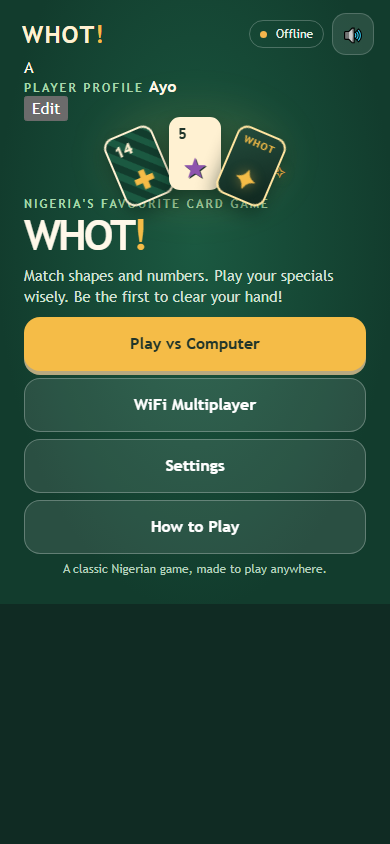
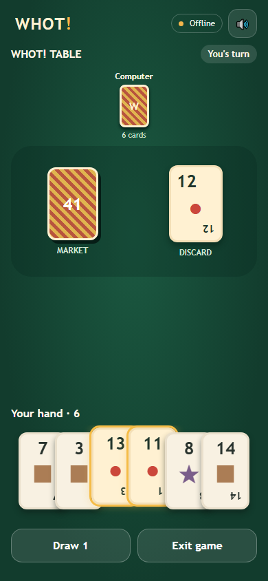
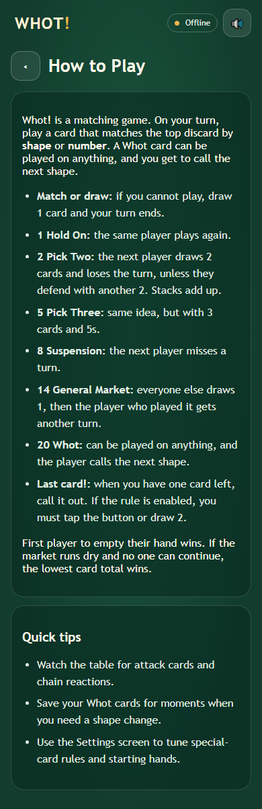

# Whot! visual theme system

This theme package is intentionally limited to styling and assets. It does not change the game logic and is designed to be layered on top of the existing Whot app shell.

## Files
- `theme.css` — global theme tokens for Classic Felt, Lagos Night, and Harmattan Day
- `cards.css` — card face and card-back styling, plus state handling (`data-state`)
- `components.css` — buttons, chips, modals, banners, toggles, shape picker, layout helpers
- `animations.css` — deal/play/draw/banner/confetti motion with `prefers-reduced-motion` fallback
- `cards.js` — creates the SVG sprite and builds each card DOM from shape + number
- `theme-preview.html` — a style-guide page to check all colours, components, banners, cards and the sample table
- `screenshots/` — mobile screenshots of the home, game table, and How to Play screens

## App screenshots

Captured from the running app at a 390 × 844 mobile viewport.

### Home

### Game table

### How to Play

## Card DOM contract
- `
...
`
- `

`

## Class list
- `.card` — base card styling
- `.card--whot` — Whot card treatment
- `.card--back` — card back treatment
- `.card__corner`, `.card__number`, `.card__mini` — corners and symbol markup
- `.card__inner`, `.card__shape-wrap`, `.card__shape` — center panel and symbol display
- `.card__badge` — special card effect badges
- `.card__whot-wordmark`, `.card__whot-ring` — Whot wordmark and five-shape ring
- `.btn`, `.btn--primary`, `.btn--secondary`, `.btn--outline-cream` — action buttons
- `.theme-switcher`, `.segmented`, `.toggle`, `.wifi-chip` — controls
- `.banner`, `.banner--win`, `.banner--alert` — call-out banners
- `.shape-option` — shape selector tile
- `.panel`, `.preview-shell`, `.swatch-card` — preview page layout

## Data attributes
- `data-theme` — theme name on the root element (`classic`, `lagos-night`, `harmattan-day`)
- `data-shape` — card shape (`circle`, `triangle`, `cross`, `square`, `star`, `whot`)
- `data-number` — card numeric value (`1` to `14` or `20`)
- `data-state` — card state (`playable`, `selected`, `dimmed`, `invalid`)
- `data-badge` — special effect badge key (`hold`, `plus-two`, `plus-three`, `skip`, `market`)

## Theme tokens
The key theme variables are defined in `theme.css`:
- `--base-bg`, `--base-bg-2`
- `--gold`, `--gold-2`, `--gold-3`
- `--cream`, `--card-surface`, `--card-ink`
- `--text-main`, `--text-muted`
- `--shape-circle`, `--shape-triangle`, `--shape-cross`, `--shape-square`, `--shape-star`
- `--theme-color`

## Contrast pairs

| Pair | Hex | Ratio |
|---|---:|---:|
| `--card-ink` on `--card-surface` | `#1c2d29` on `#fff8e7` | 11.4:1 |
| `--gold` on `--button-ink` | `#f5b83d` on `#1a2c27` | 4.9:1 |
| `--text-main` on `--base-bg` | `#fdf7ef` on `#0b3d2e` | 10.1:1 |
| `--text-main` on `--base-bg` (Lagos Night) | `#f4f0ff` on `#0a1230` | 11.3:1 |
| `--card-ink` on `--card-surface` (Harmattan Day) | `#102c2b` on `#ffffff` | 12.7:1 |

## Open-source font note
The bundled local font files are copied from the package fonts that ship under the SIL Open Font License: Fredoka and Nunito. The browser loads them locally, so the app remains fully offline.

## Theme switcher
Use the root `data-theme` attribute to swap themes instantly:
- `classic`
- `lagos-night`
- `harmattan-day`

The preview page also updates the `theme-color` meta tag on theme change.
